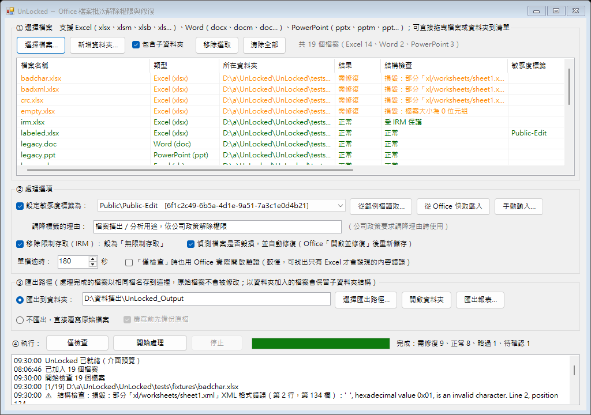

# UnLocked － Office 檔案批次解除權限與修復工具

公司導入新的資訊保護政策後，檔案若要攜出或做分析，必須先：

1. 把 **敏感度標籤** 改成 `Public\Public-Edit`（Excel「檔案 → 資訊 → 敏感度」）
2. 把 **限制存取 (IRM)** 改成「**無限制存取**」（「保護活頁簿 → 限制存取 → EVAAIR → 無限制存取」）
3. 檔案若在開啟時出現「**Excel 已完成檔案層級的驗證和修復**」，代表檔案有毀損，需要修復後另存

檔案一多，一個一個手動處理很花時間。UnLocked 可以一次處理整批檔案（含子資料夾），並在處理前、後檢查檔案是否毀損。

---

## 功能

| 功能 | 說明 |
| --- | --- |
| 批次設定敏感度標籤 | 透過 Office 本身的 API 套用標籤（等同使用者手動選擇），可填寫調降理由 |
| 批次移除限制存取 (IRM) | 等同「限制存取 → 無限制存取」；需要您對檔案有完整控制（擁有者）權限 |
| 毀損偵測 | 不開 Office 就能檢查：ZIP 結構、CRC 校驗、XML 格式、缺少的部分／關聯、OLE 結構；並辨識 IRM 保護、開啟密碼 |
| 自動修復 | 偵測到毀損時以 Office「開啟並修復」開啟後重新儲存；Excel 嚴重毀損時最後會嘗試「僅擷取資料」。會讀取 Excel 的修復紀錄 (error\*.xml) 並寫進報表 |
| 輸出驗證 | 儲存後再檢查一次輸出檔：結構是否正常、標籤是否為目標標籤、IRM 是否已移除 |
| 自選檔案與匯出路徑 | 用「選擇檔案…」挑選檔案（或整個資料夾、拖曳），用「選擇匯出路徑…」指定存放位置；預設原檔不動、保留子資料夾結構，也可改為覆寫原檔並自動備份 |
| 報表 | 每次執行都會產生 `.log` 與 `.csv` 報表（Excel 可直接開啟） |
| 防卡死 | 每個檔案有逾時限制；Office 若被看不見的視窗卡住，會自動結束該 Office 程序並繼續下一個檔案 |

### 支援的檔案格式

| Office 程式 | 一般檔案 | 啟用巨集 | 舊版格式 | 範本／放映檔 |
| --- | --- | --- | --- | --- |
| **Excel** | `.xlsx` `.xlsb` | `.xlsm` | `.xls` | `.xltx` `.xltm` `.xlt` |
| **Word** | `.docx` | `.docm` | `.doc` | `.dotx` `.dotm` `.dot` |
| **PowerPoint** | `.pptx` | `.pptm` | `.ppt` | `.ppsx` `.ppsm` `.pps` `.potx` `.potm` `.pot` |

- 同一批可以混合 Excel、Word、PowerPoint 檔案，程式會自動交給對應的 Office 程式處理，另存時保持原本的格式與副檔名。
- 敏感度標籤只支援 Open XML 格式（x 結尾的格式與 `.xlsb`）；舊版格式（`.xls/.doc/.ppt` 等）只處理 IRM 與修復。
- 巨集不會被執行，但會保留在檔案中。

---

## 系統需求

- Windows 10 / 11（內建 Windows PowerShell 5.1，不需另外安裝）
- Microsoft 365 版 Office（Excel / Word / PowerPoint），並已用公司帳號登入
  - 以程式設定敏感度標籤需要支援 `SensitivityLabel` API 的 Office 版本
- 移除 IRM 需要您是檔案擁有者或具有「完整控制」權限

---

## 安裝與啟動

1. 下載整個資料夾（或 ZIP 後解壓縮）。若是從網路下載的 ZIP，建議先在 ZIP 上按右鍵 → 內容 → 勾選「解除封鎖」再解壓縮。
2. 雙擊 **`UnLocked.bat`** 開啟程式。
   - 也可以把檔案或資料夾直接拖曳到 `UnLocked.bat` 上，會自動加入清單。
3. 建議處理前先關閉所有 Excel / Word / PowerPoint 視窗。

### 使用 UnLocked.exe（免 .bat）

也可以把程式打包成單一個 **`UnLocked.exe`**，雙擊就能開啟，不會出現黑色主控台視窗。
`UnLocked.exe` 內含全部指令碼，在本程序內以 Windows 內建的 PowerShell 引擎執行，第一次啟動時會把指令碼解出到 `%LOCALAPPDATA%\UnLocked\app\`。

**方法一：用 VS Code 建置（推薦）**

1. 用 VS Code 開啟 UnLocked 資料夾（檔案 → 開啟資料夾）。
2. 按 **`Ctrl+Shift+B`**（或「終端機 → 執行建置工作」→「建置 UnLocked.exe」）。
3. 完成後在 **`dist\UnLocked.exe`** 取得執行檔。

> 建置使用 Windows 內建的 C# 編譯器（.NET Framework 4.x 的 `csc.exe`），**不需要安裝 Visual Studio 或 .NET SDK**。
> VS Code 中另有「執行測試」與「建置並執行 UnLocked.exe」工作可用（終端機 → 執行工作）。

**方法二：直接雙擊 `build.bat`**，結果同樣在 `dist\UnLocked.exe`。

**方法三：從 GitHub 下載**：每次推送程式碼後，GitHub Actions 會自動建置並測試，在該次執行頁面的 **Artifacts → `UnLocked-exe`** 即可下載。

注意事項：

- 修改 `src\` 內的指令碼後要重新建置，exe 才會包含新的內容。
- 要讓同事共用標籤設定，把 `config.json` 放在 `UnLocked.exe` 同一個資料夾即可。
- 命令列模式一樣可用；因為 exe 是視窗程式，在 cmd 中請加 `start /wait` 才會等它執行完，例如：`start /wait UnLocked.exe -NoGui -CheckOnly "D:\RAW DATA"`。
- 自行建置的 exe 沒有數位簽章，第一次執行時 Windows SmartScreen 可能提示「Windows 已保護您的電腦」（按「其他資訊 → 仍要執行」），公司的防毒／應用程式管控也可能攔截。正式發佈建議請 IT 以公司憑證簽章（`signtool sign`）或加入允許清單。
- 群組原則若禁止執行 PowerShell 指令碼，exe 一樣無法執行（不會繞過公司原則）。

---

## 第一次使用：設定目標標籤

Office 套用標籤需要標籤的 ID（GUID），最簡單、最可靠的取得方式是「從範例檔讀取」：

1. 用 Excel 開啟任一個檔案 → 檔案 → 資訊 → **敏感度** → `Public` → **`Public-Edit`** → 儲存。
2. 在 UnLocked 按 **「從範例檔讀取…」**，選擇剛剛那個檔案。
3. 確認顯示名稱（例如 `Public\Public-Edit`）後按確定。之後就會一直記住這個設定。

> 其他方式：
> - **從 Office 快取載入**（實驗性）：掃描 `%LOCALAPPDATA%\Microsoft\Office\CLP` 的標籤原則快取。
> - **手動輸入**：向 IT 索取標籤 ID 與租用戶 ID (SiteId)。

---

## 使用步驟



1. **① 選擇檔案**：按 **「選擇檔案…」**（可按住 Ctrl／Shift 一次選多個，檔案類型可切換「Excel／Word／PowerPoint」），
   或按「新增資料夾…」一次加入整個資料夾，也可以直接把檔案拖曳到清單。清單會顯示每個檔案的類型，上方顯示各類型的數量。
2. **② 處理選項**：
   - ☑ 設定敏感度標籤為 `Public\Public-Edit`（可填寫調降理由）
   - ☑ 移除限制存取（IRM）：設為「無限制存取」
   - ☑ 偵測檔案是否毀損，並自動修復
3. **③ 匯出路徑**：按 **「選擇匯出路徑…」** 指定處理後檔案要存放的資料夾（預設為桌面的 `UnLocked_Output`）。
   - 檔名不變，原始檔案不會被修改；以資料夾加入的檔案會在匯出資料夾中保留原本的子資料夾結構。
   - 也可以改選「不匯出，直接覆寫原始檔案」（建議勾選「覆寫前先備份原檔」）。
4. **④ 執行**：可先按 **「僅檢查」** 只檢查毀損、目前標籤與 IRM 狀態，不會修改任何檔案
   （勾選「『僅檢查』時也用 Office 實際開啟驗證」可找出只有 Office 才會發現的內容錯誤，較慢）；
   再按 **「開始處理」**。清單會即時顯示每個檔案的結果；完成後可按「③ 匯出路徑」旁的「開啟資料夾」查看結果，或「匯出報表…」。
   在清單上雙擊某一列，可在檔案總管中顯示該檔案（處理後則顯示輸出檔）。

### 結果說明

| 結果 | 意義 |
| --- | --- |
| 成功 | 已完成設定並儲存 |
| 無需變更 | 已經是目標標籤、沒有 IRM、檔案也正常（另存模式下會直接複製到輸出資料夾） |
| 警告 | 已儲存，但有部分項目沒完成（例如沒有權限移除 IRM），請看「說明」欄 |
| 失敗 | 無法處理，原因寫在「說明」欄 |
| 略過 | 檔案有開啟密碼，需要先手動移除密碼 |
| 需修復 / 正常 / 待確認 | 「僅檢查」模式的結果；「待確認」表示檔案格式無法直接辨識（例如被公司 DRM 加密），需用 Office 深度驗證 |

---

## 每個檔案的處理流程

1. **結構檢查**（不需 Office）
   - OOXML（xlsx/docx/pptx）：ZIP 中央目錄、每個部分的解壓縮與 CRC、XML 是否格式正確（含非法字元）、`[Content_Types].xml`、`_rels` 關聯是否指向不存在的部分、主要文件部分是否存在；同時讀出目前的敏感度標籤。
   - OLE 複合檔（xls/doc/ppt 及受 IRM／密碼保護的 OOXML）：檔頭、配置表、目錄與資料流磁區鏈；判斷是否為 IRM 保護或密碼加密。
2. **以 Office 開啟**：檢查到毀損時直接用「開啟並修復」；一般開啟失敗也會自動改用修復模式（Excel 最後還會嘗試「僅擷取資料」）。
3. **設定敏感度標籤**（`SensitivityLabel.SetLabel`，指派方式 = Privileged，等同使用者手動設定）。
4. **移除限制存取**（`Permission.Enabled = False`，等同「無限制存取」）。
   若目標標籤本身就帶有加密保護，則保留標籤的保護設定。
5. **另存**：先存成暫存檔，成功後才取代目標檔（覆寫模式會先備份原檔到 `_UnLocked_Backup_日期時間` 資料夾）。由 Office 重新寫出的檔案即為修復後的檔案。
6. **驗證輸出檔**：再做一次結構檢查並確認標籤與 IRM 狀態。

---

## 命令列模式

```bash
powershell -NoProfile -ExecutionPolicy Bypass -File src\UnLocked.ps1 -NoGui -CheckOnly "D:\RAW DATA"
```

```bash
powershell -NoProfile -ExecutionPolicy Bypass -File src\UnLocked.ps1 -NoGui "D:\RAW DATA" -OutputFolder "D:\攜出"
```

| 參數 | 說明 |
| --- | --- |
| `-NoGui` | 以命令列模式執行（未指定則開啟圖形介面） |
| `-CheckOnly` / `-DeepCheck` | 只檢查；`-DeepCheck` 另外用 Office 實際開啟驗證 |
| `-OutputFolder <路徑>` | 輸出資料夾（預設使用介面中儲存的設定） |
| `-InPlace` / `-NoBackup` | 覆寫原檔／覆寫時不備份 |
| `-LabelId <GUID>` `-LabelName <名稱>` `-SiteId <GUID>` | 指定標籤（預設使用介面中選擇的標籤） |
| `-NoLabel` `-NoIrm` `-NoRepair` | 不設定標籤／不移除 IRM／不修復 |
| `-Justification <文字>` | 調降標籤的理由 |
| `-TimeoutSeconds <秒>` | 單檔逾時 |
| `-NoRecurse` | 不包含子資料夾 |
| `-ForceResave` | 即使沒有變更也一律用 Office 重新儲存 |
| `-ReportPath <路徑>` | CSV 報表位置 |

結束代碼：`0` 全部完成、`1` 有檔案失敗或找不到檔案、`2` 初始化失敗。

---

## 設定檔

- 個人設定存在 `%APPDATA%\UnLocked\config.json`（標籤清單、選項、輸出資料夾）。
- **要讓同事共用標籤設定**：把自己的 `config.json` 複製到 UnLocked 資料夾根目錄（與 `UnLocked.bat` 同一層）。沒有個人設定的人啟動時會自動載入它。格式可參考 `config.sample.json`。

---

## 常見問題

**雙擊 `UnLocked.bat` 沒有反應或出現「已停用指令碼執行」**
公司群組原則可能禁止 PowerShell 指令碼，請洽 IT 開放，或請 IT 以簽章方式發佈。

**「設定標籤失敗」**
- Office 版本太舊（需 Microsoft 365 版）、或該標籤未發佈給您的帳號。
- 公司規定調降標籤需要理由時，請填寫「調降標籤的理由」。
- 請確認標籤 ID 正確：重新用「從範例檔讀取…」取得最可靠。

**「移除限制存取失敗」**
只有檔案擁有者或具「完整控制」權限的人可以移除 IRM。請聯絡檔案擁有者。

**「處理逾時」**
通常是 Office 在背景跳出看不見的視窗（例如 IRM 需要登入、使用者自訂權限的標籤要求設定權限）。
請先用 Excel 手動開一個受保護的檔案完成登入；`Public-User Defined` 這類「使用者自訂權限」標籤需要人工設定，無法自動化。

**修復後內容有少東西嗎？**
Excel 修復時可能會移除無法讀取的內容；報表的「說明」欄會列出 Excel 的修復紀錄，請抽查重要檔案。

**公司 DRM（畫面浮水印、`.dsclient-tmp` 暫存資料夾）**
本工具處理的是 Microsoft 的敏感度標籤與 IRM。若檔案另外被公司 DRM 用戶端加密，結構檢查會顯示「無法辨識」，改由 Office 判斷；儲存後的檔案也可能再次被 DRM 加密，此時會註明「輸出檔無法直接驗證」。

---

## 安全性

- 全部在本機執行，不會上傳任何檔案或資料。
- 使用您本人的 Office 與帳號權限，**只能做您本來就能在 Office 中手動完成的動作**，不會、也無法繞過權限。
- 請依公司資訊安全政策使用（例如僅對核准攜出／分析的檔案解除權限）。

---

## 檔案結構

```
UnLocked.bat             啟動程式（雙擊）
build.bat                建置 dist\UnLocked.exe（VS Code：Ctrl+Shift+B）
config.sample.json       設定檔範例
build/                   exe 啟動程式原始碼、圖示、應用程式資訊清單
.vscode/tasks.json       VS Code 建置／測試工作
src/UnLocked.ps1         進入點（圖形介面／命令列）
src/UnLockedGui.ps1      圖形介面
src/UnLockedEngine.ps1   批次處理流程
src/UnLockedCore.ps1     設定、Office 自動化、標籤與 IRM
src/FileInspector.cs     檔案結構檢查（ZIP/CRC/XML/OPC/OLE）
src/OfficeInterop.cs     逾時看門狗、COM 訊息篩選器
tests/                   自動測試與測試用範例檔
```

## 開發與測試

```bash
python tests/make_fixtures.py
```

```bash
powershell -NoProfile -ExecutionPolicy Bypass -File tests\Test-UnLocked.ps1
```

測試不需要 Office：會檢查所有指令碼的語法與編碼、在 Windows PowerShell 5.1 下編譯 C# 類別，並用正常／各種毀損／受保護的範例檔驗證結構檢查。GitHub Actions 會在 Windows 上自動執行，並另外建置 `UnLocked.exe`、以命令列模式實際執行一次檢查做為冒煙測試。
